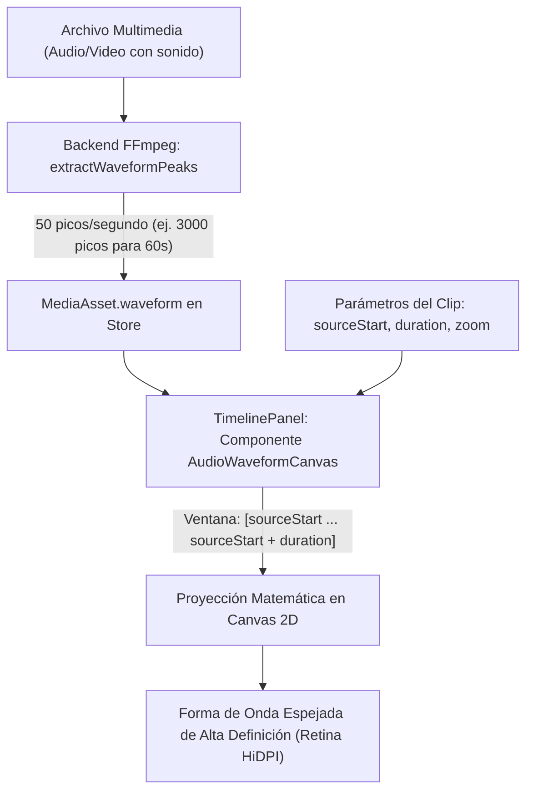

# FASE 12: Visualización de Formas de Onda de Audio de Alta Definición en la Línea de Tiempo

Este documento especifica el diagnóstico técnico, la arquitectura de renderizado, el modelo de muestreo y el plan de implementación para dotar a **VOSTOK EDITOR** de una visualización de formas de onda de audio profesional, precisa y de alto rendimiento en la línea de tiempo.

---

## 1. Visión General y Diagnóstico

### 1.1. Diagnóstico del Sistema Actual
Actualmente, la representación de formas de onda presenta limitaciones técnicas significativas:
1. **Muestreo Estático Insuficiente en Backend ([`server/mediaBackendPlugin.ts`](file:///home/vladivostok/Documentos/EDITOR%20DE%20VIDEO/server/mediaBackendPlugin.ts)):**
   La función `extractWaveformPeaks` extrae una cantidad fija de 100 muestras para todo el archivo, sin importar si dura 3 segundos o 10 minutos. Para audios largos, 100 muestras reducen la forma de onda a una aproximación tosca sin detalle de transitorios ni silencios.
2. **Visualización Primitiva en Frontend ([`TimelinePanel.tsx`](file:///home/vladivostok/Documentos/EDITOR%20DE%20VIDEO/src/components/TimelinePanel.tsx)):**
   El timeline toma únicamente los primeros 60 valores del array (`asset.waveform.slice(0, 60)`) y genera 60 etiquetas `<div>` HTML individuales:
   * **Inmune al recorte (`sourceStart`):** Si un clip de audio de 3 minutos se recorta para iniciar en el minuto 1:30, la interfaz sigue dibujando los primeros 60 puntos del inicio del archivo original.
   * **Inmune al zoom del timeline:** Al alejar o acercar el zoom, los 60 `<div>` simplemente se comprimen o expanden como barras estiradas sin aumentar ni reducir el nivel de detalle temporal.
   * **Sobrecarga de Nodos DOM:** Cada clip genera decenas de nodos HTML independientes que saturan el árbol de renderizado en proyectos con múltiples pistas.
   * **Ausencia en Clips de Video con Sonido:** Los videos que contienen pistas de audio no muestran su forma de onda integrada en la pista correspondiente.

### 1.2. Evaluación y Descarte de Bibliotecas Pesadas (ej. WaveSurfer.js)
Se evaluó la viabilidad de integrar librerías como WaveSurfer.js y se desaconsejó categóricamente por razones de arquitectura:
* **Consumo Excesivo de Memoria RAM:** WaveSurfer decodifica el audio completo en memoria sin comprimir mediante la API `AudioContext.decodeAudioData()`. En archivos de audio medianos o largos (música, grabaciones de 30 a 60 minutos), esto satura rápidamente cientos de megabytes de RAM, provocando cierres o congelamientos en WebKitGTK sobre Linux.
* **Desacople del Motor NLE:** WaveSurfer está diseñado como un reproductor autónomo con su propio transporte de tiempo, no como un sistema de clips recortables (`sourceStart`, `duration`), pistas apiladas y zoom sincronizado al milisegundo con una regla de tiempo multipista.
* **Sobrecarga Innecesaria:** El editor ya cuenta con un backend rápido basado en FFmpeg que puede entregar los picos normalizados en milisegundos sin sobrecargar el hilo principal del cliente.

### 1.3. Solución Estándar NLE (Estilo DaVinci Resolve / Adobe Premiere)
La arquitectura adoptada es la utilizada por los editores no lineales de clase profesional:
1. **Extracción en Backend por Tasa Temporal (FFmpeg):** Muestreo a razón de **50 a 100 picos por segundo de audio** (`samplesCount = Math.max(100, Math.round(duration * 50))`). Para 1 minuto de audio son ~3.000 números flotantes normalizados (~6 KB de datos en JSON), imperceptible para la red y la memoria.
2. **Renderizado Acelerado en `<canvas>` 2D Nativo:** Sustitución de los elementos `<div>` por un elemento `<canvas>` liviano dentro de cada clip de audio, calculando matemáticamente la ventana de recorte visible y trazando una onda simétrica espejada y nítida.

---

## 2. Arquitectura Técnica y Flujo de Datos



### 2.1. Optimización en el Servidor Backend (`server/mediaBackendPlugin.ts`)
En la función de inspección de medios (`getMediaInfo`), se vincula la cantidad de muestras extraídas con la duración real del archivo:

```typescript
// server/mediaBackendPlugin.ts
const SAMPLES_PER_SECOND = 50; // 50 muestras por segundo ofrecen detalle de transitorios de 20ms

let waveform: number[] | undefined;
if (type === 'audio' || (type === 'video' && hasAudio)) {
  const targetSamples = Math.max(120, Math.min(10000, Math.round(duration * SAMPLES_PER_SECOND)));
  waveform = await extractWaveformPeaks(filePath, targetSamples);
}
```

La lectura mediante FFmpeg (`-ar 1000 -ac 1 -f s16le pipe:1`) se ejecuta en streaming directo mediante buffer binario, completándose en ~50-150 ms incluso para pistas completas.

### 2.2. Componente de Renderizado Frontend (`src/components/AudioWaveformCanvas.tsx`)
Se crea un componente especializado y memoizado para gestionar el dibujo de la forma de onda:

#### Especificación de Props:
```typescript
interface AudioWaveformCanvasProps {
  waveform: number[];       // Picos normalizados [0.0 - 1.0] del asset completo
  assetDuration: number;    // Duración total del archivo en segundos
  sourceStart: number;      // Tiempo inicial recortado del clip en segundos
  clipDuration: number;     // Duración efectiva del clip en la pista
  width: number;            // Ancho visible en píxeles (clipDuration * timelineZoom)
  height: number;           // Alto del canvas (ej. 32px o 40px)
  className?: string;
  waveColor?: string;       // Color principal (ej. esmeralda #10b981 o cian #00d4e5)
}
```

#### Mapeo Matemático de Ventana Temporal:
Dado un array global de picos $P$ de tamaño $N$:
1. **Índice inicial en el array:**
   $$i_{\text{start}} = \left\lfloor \frac{\text{sourceStart}}{\text{assetDuration}} \times N \right\rfloor$$
2. **Índice final en el array:**
   $$i_{\text{end}} = \left\lceil \frac{\text{sourceStart} + \text{clipDuration}}{\text{assetDuration}} \times N \right\rceil$$
3. **Subconjunto de muestras visibles:**
   $$P_{\text{visible}} = P[i_{\text{start}} \dots i_{\text{end}}]$$

#### Algoritmo de Trazado en Canvas 2D:
* **Soporte HiDPI (`window.devicePixelRatio`):** Escala el canvas interno por el pixel ratio del monitor para eliminar bordes borrosos en pantallas 2K/4K o pantallas Retina.
* **Onda Espejada Simétrica:** Se dibuja tanto hacia arriba como hacia abajo desde el centro vertical ($Y_{\text{center}} = \text{height} / 2$).
* **Resolución Adaptativa por Píxel:** Si el ancho del clip en píxeles es $W$:
  * Si hay más muestras que píxeles ($M > W$), se calcula el valor pico máximo por cada columna de píxel para no perder transitorios acústicos.
  * Si hay menos muestras que píxeles ($M < W$), se interpola linealmente o se dibujan barras con espaciado constante uniforme.
* **Paleta Estética Profesional:** Trazo en gradiente esmeralda (`#10b981` a `#00d4e5`) o cian neutro translúcido con relleno suave y línea central sutil.

---

## 3. Objetivos de la Fase 12

1. **Precisión Milimétrica al Recortar (*Trimming & Slip*):**
   Al desplazar el inicio del clip (`sourceStart`) o acortar su duración, la forma de onda debe reflejar fielmente la sección exacta del audio que se está escuchando, facilitando cortes al ritmo de la voz o de la música.
2. **Escalabilidad Fluida al Zoom:**
   Desde un zoom mínimo (visión global del proyecto) hasta un zoom máximo (edición quirúrgica fotograma a fotograma), la onda debe mantenerse nítida sin deformarse ni perder coherencia visual.
3. **Rendimiento Cero-Costo en WebKitGTK (Tauri Linux):**
   Erradicar los cientos de etiquetas `<div>` del DOM, reduciendo el costo de composición a una única textura de canvas 2D acelerada por hardware.
4. **Base Visual para la Fase 11 (Sistema de Keyframes):**
   Dejar la superficie del clip de audio lista para que la línea elástica de volumen (*rubber-band*) y los rombos de keyframes de la Fase 11 se superpongan directamente sobre la onda.

---

## 4. Plan de Implementación Paso a Paso

### Paso 1: Optimización de Extracción en Servidor Backend
* Modificar [`server/mediaBackendPlugin.ts`](file:///home/vladivostok/Documentos/EDITOR%20DE%20VIDEO/server/mediaBackendPlugin.ts):
  * Ajustar `extractWaveformPeaks` para recibir `samplesCount` calculado en base a `Math.max(120, Math.round(duration * 50))`.
  * Garantizar la extracción tanto para archivos de audio dedicados (`type === 'audio'`) como para videos con audio (`type === 'video' && hasAudio`).

### Paso 2: Creación del Componente `AudioWaveformCanvas`
* Crear [`src/components/AudioWaveformCanvas.tsx`](file:///home/vladivostok/Documentos/EDITOR%20DE%20VIDEO/src/components/AudioWaveformCanvas.tsx):
  * Manejo del ciclo de vida del canvas mediante `useRef` y `useEffect`.
  * Ajuste de resolución de densidad de píxeles (`devicePixelRatio`).
  * Cálculo de subsegmento `[sourceStart, sourceStart + duration]`.
  * Dibujo eficiente de la onda espejada simétrica con esquinas redondeadas o barras continuas.

### Paso 3: Integración en `TimelinePanel.tsx`
* Sustituir el bloque actual de 60 `<div>`s en [`src/components/TimelinePanel.tsx`](file:///home/vladivostok/Documentos/EDITOR%20DE%20VIDEO/src/components/TimelinePanel.tsx#L1314) por `<AudioWaveformCanvas />`.
* Pasar las propiedades:
  * `waveform={asset.waveform}`
  * `assetDuration={asset.duration}`
  * `sourceStart={clip.sourceStart ?? 0}`
  * `clipDuration={clip.duration}`
  * `width={clip.duration * timelineZoom}`
  * `height={28}`
* Habilitar también la visualización en clips de video en pistas de audio desvinculadas o vinculadas.

### Paso 4: Pruebas y Verificación
* Validar que al cambiar el zoom del timeline los canvas se actualicen con nitidez instantánea.
* Validar que al recortar con las manijas izquierda/derecha de un clip de audio, la onda se desplace con absoluta fidelidad.
* Ejecutar verificación de tipos de TypeScript y compilación de producción (`npm run build`).
