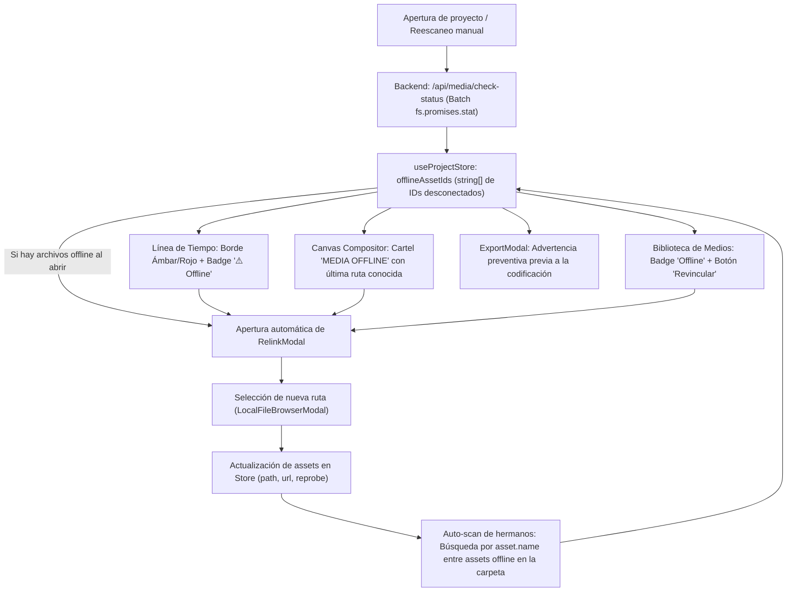

# FASE 13: Detección de Media Offline, Advertencia Visual y Herramienta de Re-vinculación (Relink Media)

Este documento establece la arquitectura, diseño de interfaz y plan de implementación para dotar a **VOSTOK EDITOR** de un sistema profesional de detección de medios desconectados (*Offline Media*), señalización visual en el timeline y lienzo, y una herramienta intuitiva de re-vinculación (*Relink / Locate Media*).

---

## Estado verificado — 2026-11-04

Inspección estática del árbol de trabajo con HEAD `4564f63`, incluidos cambios locales; no se ejecutaron pruebas ni compilaciones. Se preservan la necesidad original, el diseño y los resultados históricos sin convertirlos en validación vigente.

- **Implementado:** `/api/media/check-status` usa `fs.promises.stat`; `openProject` invoca `checkProjectMediaStatus(true)` y abre el modal ante ausencias. Existen reescaneo manual, badges, tarjeta Canvas, `RelinkModal`, selección mediante explorador interno y advertencia de exportación.
- **Parcialmente implementado:** `relinkAsset` conserva IDs y actualiza metadatos; busca otros assets ya marcados offline mediante rutas candidatas `${targetDir}/${asset.name}`. No compara el tipo anterior con el reemplazo ni reconcilia límites de los clips. El pool de `CanvasPreviewStage.tsx` crea elementos solo si falta `clip.id`, por lo que cambiar la ruta del asset no actualiza la fuente de un elemento existente. Esto puede impedir restaurar la reproducción aunque el estado deje de marcarlo offline.
- **Pendiente:** detección en caliente y ante errores de reproducción/404, revalidación antes de exportar, validación de compatibilidad e invalidación de fuentes cargadas. No hay vigilancia de archivos en los llamadores inspeccionados. Las respuestas de comprobación tampoco se vinculan a una revisión del proyecto abierto.
- **Riesgo estático en borradores:** `ExportModal.tsx` intenta iniciar el lector de todo video activo, incluidos los ausentes; el backend rechaza una ruta inexistente. La exportación puede abortar antes de dibujar la tarjeta offline. El diálogo existe, pero no garantiza un borrador con video ausente. No se reprodujo el fallo en esta revisión.
- **Resultados históricos no revalidados:** el registro anterior declara un script E2E aprobado y `npm run build` con código 0. No se localizó ese script ni un resultado reproducible asociado al árbol actual. Se conserva la declaración sin negar una posible ejecución histórica. Tampoco se han revalidado latencias menores de 10 ms ni retrocompatibilidad del 100%.

Evidencia: `server/mediaBackendPlugin.ts`, `src/store/useProjectStore.ts`, `src/components/CanvasPreviewStage.tsx`, `src/components/RelinkModal.tsx` y `src/components/ExportModal.tsx`. Véanse [contexto](../CONTEXTO_PROYECTO.md) y [auditoría](audits/AUDITORIA_TECNICA_2026-11-04.md).

## 1. Diagnóstico y Necesidad del Sistema

### 1.1. Contexto histórico previo a la fase
En un editor no lineal (NLE) de escritorio que trabaja mediante referencias locales directas sin duplicar archivos en disco (filosofía central de VOSTOK EDITOR), es muy común que el usuario:
1. Cambie de carpeta un archivo (`~/Descargas/video.mp4` $\rightarrow$ `~/Vídeos/Proyecto/video.mp4`).
2. Renombre una carpeta contenedora o un disco externo.
3. Elimine por error un clip del almacenamiento local.

El diagnóstico original describía la ausencia de archivos como segura pero silenciosa (antecedente no revalidado; no describe el estado actual):
* El proyecto no colapsa ni crashea.
* La miniatura en la biblioteca y la onda acústica en el timeline se siguen mostrando porque se guardan en el archivo de proyecto JSON.
* **El problema:** Al reproducir, el Canvas muestra la capa en negro sin ninguna explicación y el audio queda mudo; al exportar, el video se genera con fotogramas negros o pistas descartadas sin advertencia previa al usuario. Tampoco existe un mecanismo dentro de la interfaz para apuntar el medio a su nueva ubicación sin tener que borrarlo y volver a armar todos los cortes y keyframes.

### 1.2. Objetivo de la Fase 13

Se conservan los objetivos originales; su estado de implementación se distingue al inicio.

* **Detección Proactiva:** Identificar en tiempo récord cuáles archivos multimedia están desconectados tanto al abrir el proyecto como en caliente si se mueven o borran.
* **Advertencia Visual Cinematográfica en Canvas:** Marcar de forma limpia y estilizada los clips afectados en el timeline, en la biblioteca de medios y con un cartel técnico de **`MEDIA OFFLINE`** directamente en el Canvas 2D (estilo DaVinci Resolve / Premiere Pro, adaptado a la estética Carbón/Cian de VOSTOK).
* **Modal Automático de Re-vinculación (*Relink / Locate Media*):** Si al abrir un proyecto hay archivos faltantes, abrir de inmediato un diálogo modal para localizarlos mediante el explorador propio de la aplicación (`LocalFileBrowserModal`), preposicionado en la carpeta original (`initialDir`), con **detección automática inteligente en lote** (si otros archivos ausentes están en la misma carpeta seleccionada, re-vincularlos en cascada).
* **Protección Preventiva en Exportación:** Alertar al usuario antes de iniciar la codificación si hay medios desconectados que resultarían en capas vacías.

---

## 2. Arquitectura Técnica

---

## 3. Especificación Detallada por Componentes

Las descripciones visuales y mensajes conservan la intención de diseño original; el estado verificado distingue sus capacidades implementadas y pendientes.

### 3.1. Capa Backend (`server/mediaBackendPlugin.ts`)
1. **Endpoint de Verificación en Lote (`/api/media/check-status`):**
   * **Método:** `POST`.
   * **Payload:** `{ assets: [{ id: string, path: string }] }`.
   * **Respuesta:** `{ status: Record<string, { exists: boolean, sizeBytes?: number, mtimeMs?: number }> }`.
   * Ejecuta llamadas asíncronas no bloqueantes con `fs.promises.stat(path)` para verificar referencias; la cifra histórica de < 10 ms no se ha revalidado.
2. **Re-vinculación con Re-probe (`/api/media/relink`):**
   * Recibe `{ assetId: string, newPath: string }`.
   * Valida existencia física y ejecuta probe. La compatibilidad con el tipo anterior es un objetivo pendiente.
   * Actualiza metadatos del asset conservando IDs y sin modificar los cortes ni keyframes. No reconcilia los límites de los clips con la nueva duración; conservar los datos no garantiza un reemplazo compatible.

---

### 3.2. Capa de Estado (`src/store/useProjectStore.ts`)
1. **Nuevo Estado:**
   * `offlineAssetIds: string[]` (Lista reactiva de IDs de assets desconectados).
   * `isRelinkModalOpen: boolean` (Control del diálogo de re-vinculación).
   * `relinkTargetAssetId: string | null` (Asset individual específico o null para todos los offline).
2. **Nuevas Acciones:**
   * `checkProjectMediaStatus(autoOpenModal?: boolean): Promise<string[]>`: invocado con `true` al abrir un proyecto (`openProject`) y con `false` desde el reescaneo manual. Si hay ausencias al abrir, abre `RelinkModal`. La llamada tras errores 404 sigue pendiente.
   * `relinkAsset(assetId: string, newFilePath: string, autoScanSiblings?: boolean): Promise<{ autoRelinkedCount: number }>`:
     * Actualiza la ruta del asset: `asset.path = newFilePath` y regenera `asset.url`.
     * **Búsqueda automática de hermanos (*Auto-Relink*):** Comprueba rutas candidatas construidas con la nueva carpeta y `asset.name` para otros assets en `offlineAssetIds`. Intenta revincular los candidatos existentes; los reprobes individuales pueden fallar.
     * Remueve los IDs resueltos de `offlineAssetIds`.
     * Actualiza el estado del proyecto y solicita persistencia en disco; la invalidación de fuentes ya cargadas en el compositor está pendiente.

---

### 3.3. Representación Visual de Media Offline

#### A. En la Línea de Tiempo (`TimelinePanel.tsx`)
* Los clips cuyos `assetId` estén en `offlineAssetIds` mostrarán:
  * **Borde superior e inferior en tono ámbar / rojo suave:** `border-red-500/60` con trama sutil diagonal tipo cinta técnica de advertencia.
  * **Insignia en cabecera:** Pequeño badge `⚠️ Desconectado` junto al nombre del archivo.
  * **Menú Contextual (Clic Derecho sobre el clip):** Opción destacada con ícono de enlace: **`🔗 Re-vincular archivo...`**.

#### B. En el Visor / Compositor Canvas (`CanvasPreviewStage.tsx`)
* Cuando la aguja de reproducción (*playhead*) intersecta un clip desconectado:
  * El Canvas dibuja una tarjeta de advertencia técnica directamente en la textura 2D dentro de `drawSingleClipToContext`:
    * Fondo con degradado carbón profundo `#18191c` y borde sutil rojo bermellón `#ef4444`.
    * Ícono de alerta / claqueta técnica.
    * Texto principal en mayúsculas negrita: **`MEDIA OFFLINE`**.
    * Subtítulo con el nombre del clip y su última ruta conocida (truncada inteligentemente al ancho de pantalla).
    * Respeta la posición $(X, Y)$, escala y rotación del clip en el lienzo.

#### C. En la Biblioteca de Medios (`EditorWorkspace.tsx`)
* La tarjeta del medio en el cajón lateral mostrará:
  * Badge superior rojo: **`Desconectado`**.
  * Al pasar el cursor sobre la tarjeta, aparece un botón de acceso directo con ícono de enlace para re-vincularlo.
  * Un banner sutil en la cabecera de la biblioteca si existen medios offline: *"⚠️ 2 archivos no encontrados — [Re-vincular todos]"*.

#### D. En el Modal de Exportación (`ExportModal.tsx`)
* Antes de iniciar la codificación, si hay clips del timeline cuyos assets están en la lista conocida `offlineAssetIds` (sin nueva comprobación de disco):
  * Diseño original del mensaje (no garantiza el resultado del borrador; un video offline puede abortar antes de dibujar la tarjeta):
    > **⚠️ Advertencia de medios desconectados**  
    > El proyecto contiene **X archivo(s) no encontrado(s)**. Si continúas, estas partes se exportarán en negro o sin sonido.
    > * [Re-vincular ahora] o [Exportar de todos modos].

---

### 3.4. Modal de Re-vinculación (*RelinkModal.tsx*)
* Componente modal limpio con estética *glassmorphism* de VOSTOK:
  1. Se abre automáticamente al cargar un proyecto si se detectan archivos ausentes, o manualmente desde clic derecho / biblioteca.
  2. **Lista interactiva de archivos desconectados:**
     * Nombre original del archivo, tipo de medio (video, audio, imagen), duración original y última ruta registrada en el sistema.
  3. **Botón de selección "Localizar..."** que abre el explorador propio integrado (`LocalFileBrowserModal`) preposicionado en la carpeta de origen (`initialDir: path.dirname(asset.path)`).
  4. **Casilla de verificación activada por defecto:**
     * `☑ Buscar automáticamente otros archivos desconectados en la misma carpeta`.
  5. **Feedback instantáneo:**
     * Mensaje de confirmación: *"¡Archivo re-vinculado con éxito! (Se recuperaron automáticamente 3 archivos adicionales en la misma carpeta)"*.

---

## 4. Plan y registro histórico de Implementación Paso a Paso

Los pasos conservan el alcance y las declaraciones de entrega originales. Los pasos 1–3 tienen implementación presente; los cierres posteriores y los resultados de pruebas deben leerse junto al estado verificado.

1. **Paso 1: Backend de Verificación y Detección (`mediaBackendPlugin.ts`):**
   * Implementar endpoint `/api/media/check-status`.
2. **Paso 2: Store Zustand y Detección Reactiva (`useProjectStore.ts`):**
   * Añadir `offlineAssetIds`, `isRelinkModalOpen`, `relinkTargetAssetId`, `checkProjectMediaStatus` y `relinkAsset`.
   * Plan original: integrar en `loadProject` y `setCurrentProject`. La integración vigente se realiza en `openProject`.
3. **Paso 3: Señalización en Timeline y Biblioteca de Medios:**
   * Estilos de advertencia en `TimelinePanel.tsx` para clips offline.
   * Menú contextual de clic derecho con acción *"Re-vincular archivo..."*.
   * Indicador en tarjeta de biblioteca en `EditorWorkspace.tsx`.
4. **Paso 4: Compositor Canvas y Cartel "Media Offline":** ✅ Declarado completado históricamente; véanse límites actuales
   * Adaptar `drawSingleClipToContext` en `CanvasPreviewStage.tsx` para dibujar el cartel visual cinematográfico cuando el medio esté offline.
   * Renderizado técnico en Canvas 2D con fondo carbón, borde bermellón, franja superior de advertencia, título `⚠ MEDIA OFFLINE`, nombre de clip, ruta truncada y sugerencia de re-vinculación.
   * Conectado a la aguja de reproducción (*playhead*), previsualizaciones estáticas y exportaciones en `ExportModal.tsx`.
5. **Paso 5: Modal de Re-vinculación (`RelinkModal.tsx`) y Auto-Relink en Cascada:** ✅ Declarado completado históricamente; véanse límites actuales
   * Creado `src/components/RelinkModal.tsx` con soporte para lista de medios desconectados, ordenamiento prioritario por clip activo, banner de feedback y estado de finalización exitosa.
   * Integrado fluidamente con el explorador propio de VOSTOK (`LocalFileBrowserModal`) mediante nuevas props opcionales (`title`, `confirmLabel`, `singleSelection`), manteniendo 100% de retrocompatibilidad.
   * Activada casilla `☑ Buscar automáticamente otros archivos faltantes en la misma carpeta` que ejecuta auto-revinculación en cascada de hermanos vía `relinkAsset`.
   * Montado en la raíz de `EditorWorkspace.tsx`.
6. **Paso 6: Protección en Exportación y Pruebas:** ✅ Declarado completado históricamente; véanse límites actuales
   * Advertencia preventiva integrada en `ExportModal.tsx`:
     * Banner informativo en la configuración si hay clips offline en la línea de tiempo con botón de re-vinculación rápida.
     * Cuadro de diálogo de confirmación preventiva al pulsar *"Exportar"* con opciones: *"Re-vincular archivos ahora"*, *"Exportar de todos modos (Borrador)"* y *"Volver a la configuración"*.
     * Integración limpia con `openRelinkModal()`.
   * Resultado histórico declarado, no revalidado: pruebas integrales de extremo a extremo aprobadas (E2E script y `npm run build` con código 0). No se encontró el script ni evidencia reproducible asociada al estado actual.

---

## 5. Estado de Finalización: implementación parcial

**Antecedente:** el registro original declaraba “100% COMPLETADA ✅”. La declaración siguiente se conserva como resultado histórico no revalidado:

Según ese registro histórico, todas las metas de la FASE 13 (detección asíncrona no bloqueante, señalización en línea de tiempo y biblioteca, renderizado técnico cinematográfico "MEDIA OFFLINE" en Canvas 2D, modal de re-vinculación con auto-scan en cascada mediante el explorador nativo integrado `LocalFileBrowserModal`, y protección preventiva en exportación) han sido desarrolladas, integradas y verificadas rigurosamente.

---

## 6. Decisiones de Diseño Confirmadas

1. **Cartel de "MEDIA OFFLINE" en el Canvas (Confirmado):**
   * Se dibuja directamente dentro del motor de renderizado `<canvas>` 2D en `drawSingleClipToContext`.
   * Estilo técnico cinematográfico (fondo carbón degradado, recuadro de aviso, ícono de alerta, texto en negrita `MEDIA OFFLINE` y última ruta conocida del archivo).
   * Respeta de forma nativa la posición espacial, escala y rotación del clip en el lienzo.
2. **Reacción al abrir un proyecto con archivos ausentes (Confirmado):**
   * Al abrir un proyecto (`openProject`), si se detectan archivos faltantes se despliega de inmediato un **diálogo modal dedicado de re-vinculación (*RelinkModal*)** que enumera los archivos desconectados y permite localizarlos en el explorador de archivos local de Linux.
   * Cuenta con casilla activa por defecto: `☑ Buscar automáticamente otros archivos faltantes en la misma carpeta` para resolver múltiples ausencias en un solo paso.
